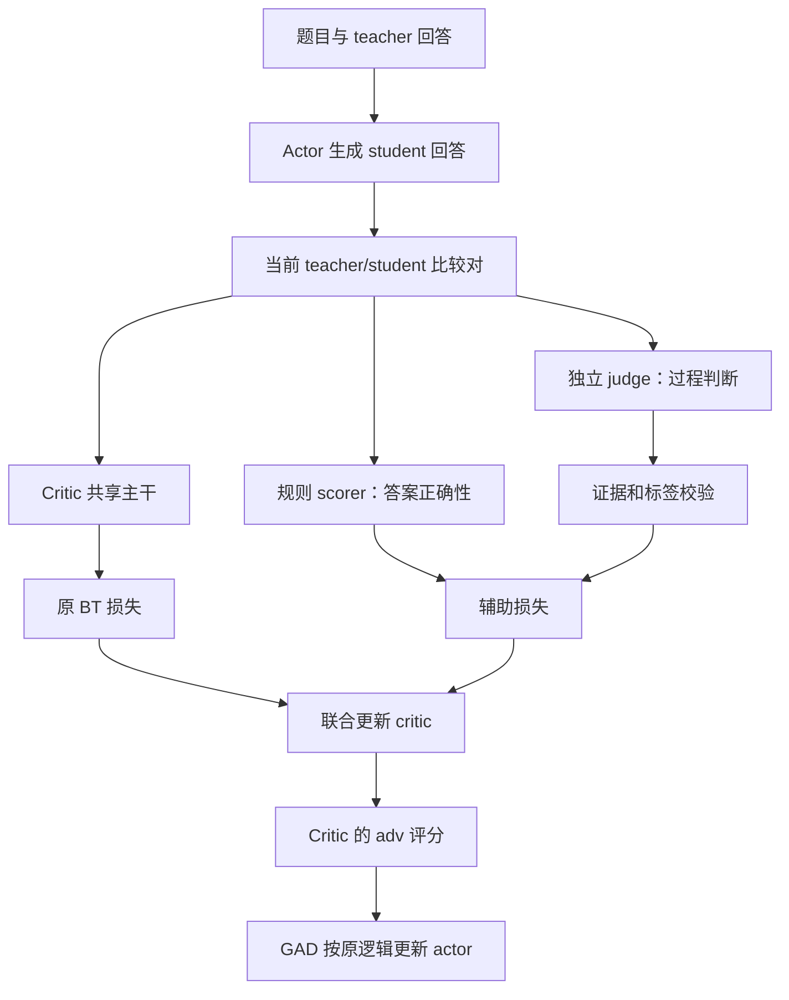

# Naive Rubric：设计演变、实验经历与当前问题

更新日期：2026-10-16。本文用于理解与交流，是设计和证据的回顾，不是新的执行计划。

记录范围：早期离线验证、5k问题审计、v2.4实施、附录A的证据压缩与并发实验，以及随后转向训练收益验证的决定。最新实测依据是 `rubric_v24_appendix_a_20261016`；最新执行安排是v2.4方案附录B。用户已启动 `correctness_06b_5k`，其配置已经只读核对；本文不报告该实验的实时进度或尚未得到的成绩。

**阅读建议：** 想快速理解和对外交流，先看第1节、第13节的简短介绍、第16节的最新决定。第2～10节解释背景和早期问题，第15节保留实验细节。第7～10节中的“当前”指10月15日当时的实现，不是后续最新版。本文更新只整理已有证据，没有重新调用Judge、启动训练或修改运行中的实验。

## 1. 先用一句话解释我们在做什么

我们希望给原 GAD 的 critic 增加一点“数学老师的训练”：除了学习区分 teacher 和 student 的回答，还学习判断回答是否正确、已经取得哪些可靠进展、有没有尚未修复的错误，从而有机会给 actor 更好的训练信号。

这条路线**尚未证明能提高 actor 的数学能力**。此前出现过错误过程标签被程序接受；后来增加复核、压缩证据并修复并发，工程上有进展，但标签仍稀疏且会误判。现在决定给Judge优化设一个停止点：修好明确的生成结构问题，做有限检查，然后通过训练实验判断是否值得继续投入。

可以把当前困难理解成三个连续的问题：

1. 老师能否正确批改？——judge 标签质量。
2. 学生助教能否学会批改，并改善原评分？——critic 的辅助学习及 adv 评分。
3. 学习者能否因此进步？——actor 的完整训练效果。

第一步没做好，第二步可能只是更认真地学习错误标签；第二步 loss 下降，也不能直接证明第三步成功。

但这不意味着必须先等Judge几乎不犯错，才可以测试训练。下一版允许带有已知噪声的探索：先确认过程标签确实进入了训练、明显的程序问题已处理，再看收益和成本。

几个术语可以这样理解：

| 术语 | 通俗理解 |
|---|---|
| Actor / Student | 正在练习解题的模型，最终要看它是否进步 |
| Teacher | 提供示例答案的模型；它的答案也可能错，不等于负责批卷的Judge |
| Judge | 批改回答的模型，产生“有何进展、哪里出错”的标签 |
| Critic | 正在学习如何打分的模型，Judge标签用来辅助训练它 |
| Progress | 回答已经取得多少可靠的解题进展 |
| Error | 回答里还有多严重的未修复错误 |
| Mask / unknown | 这项判断暂不用于训练；不是给它打零分 |
| 证据 | 支持某个判断的原文片段，例如确实写出的方程或订正步骤 |

这里最容易混淆的是“没有Error标签”：它表示这一项没教给Critic，不表示回答没有错误。

## 2. 原 GAD 和新增 rubric 各自做什么

### 2.1 原来的 critic 学习什么

每道题配一条 teacher 回答和一条 student 回答，原 BT（Bradley–Terry）损失鼓励 critic 给 teacher 更高的分数：

```text
希望：teacher 的 adv 分数 > student 的 adv 分数
```

这是“来源偏好”，不是逐题数学真值。teacher 也可能答错，student 也可能偶尔答对。保留原 BT 是本项目明确的设计约束；rubric 没有把原比较标签改成“数学正确者胜”。

### 2.2 Naive rubric 的含义

这里的 naive 指初步、固定准则的辅助训练方案：所有题使用同一套数学判据，不按题生成 rubric，不让 critic 自己演化评价规则，也不直接将步骤分数加到 actor 奖励中。

当前分工如下：

| 组件 | 通俗解释 | 实际职责 |
|---|---|---|
| Teacher | 示例回答提供者 | 提供蒸馏目标和原 BT 比较中的 teacher 回答，不默认数学正确 |
| Actor / student | 正在学习解题的模型 | 生成当前训练回答；保留用户的 non-thinking 设置 |
| Critic | 正在训练的评分器 | 对“题目＋回答”输出 adv 和三个辅助通道 |
| 规则 scorer | 最终答案检查工具 | 提取显式最终答案，按统一数学判等规则给正确性标签 |
| Judge / verifier | 负责产生过程标签的模型 | 阅读原回答，判断进展和错误；当前候选独立开启 thinking |
| Parser | 格式与证据关系检查程序 | 检查字段、片段 ID、事件关联及标签的一致性，不是数学证明器 |

Critic 当前不生成文本，因此并没有与 judge 相同的“生成 CoT”开关。Judge 的推理只用于标注与诊断，不是 student 的推理，也不作为 critic 输入或监督目标。



图中最后的 actor 更新指 GAD 阶段；Warmup 的 actor 仍按原 teacher SFT 目标及原更新门槛训练。Rubric 从 Warmup 首次 critic 更新就开始生效，之后延续到 GAD。

## 3. Rubric 如何与 BT 一起训练 critic

当前 critic 四个输出通道是：

```text
[adv, answer_correctness, verified_progress, unresolved_error_severity]
```

它们共享同一个模型主干，分别表示原判别分数、答案正确性、可靠进展和未修复错误严重程度。辅助分数在回答末有效 token 上预测，是整段回答的汇总目标；事件级证据不等于逐 token 奖励。

联合目标可写成：

```text
critic 总损失 = 原 BT 损失 + λ × rubric 辅助损失
```

当前默认 λ=0.1。三个辅助通道使用 BCEWithLogitsLoss；0.5 是一个有明确含义的软目标，不是“judge 不确定”。unknown 使用 mask，不参与该维损失。teacher/student 都可有辅助标签，重复回答按身份去重计权，跨 GPU 和 microbatch 保持全局归一化。

10月16日v2.4实施报告补充了三种可选归一化方式：原有效维度平均、固定除以三个维度、固定分母再按有效回答数门控。它们是可分开验证的设置，不代表已完成训练收益比较。本轮真实Judge窗口使用 `legacy_active` 配置，没有运行训练。

注意三个容易混淆的点：

- `error=1` 表示错误严重，不是给错误正奖励。它训练的是“预测错误严重度”的独立通道。
- Actor 仍只拿 adv 通道作为原 GAD 奖励来源，三个辅助输出没有直接加到奖励里。
- 辅助任务通过共享主干间接影响 adv。即使辅助头预测更准确，adv 排序也不一定改善；BT 的来源偏好与数学辅助任务还可能存在冲突。这是后续需要测量的假设，不是已经确认的失败原因。

实现依据：[worker.py](../gad/extensions/worker.py)、[losses.py](../rubric/core/losses.py)、[critic_batch.py](../gad/extensions/critic_batch.py)。

## 4. 为什么从离线实验走到在线 GAD

最初在独立的 `LMOps/rubric/` 中做小规模离线验证：固定 teacher/student 轨迹，只训练 critic，检查标注、辅助头、loss、保存恢复是否能工作。离线实验不是在正式 GAD 中提前训练一个以后永远冻结的 critic。

2026-10-11 的离线 smoke 使用 24 题、72 条唯一回答。37 条回答截断，过程标签按当时规则全部 unknown；35 条完整回答中 32 条最终得到合法 judge JSON，比例为 91.4%。当时 judge 是 Qwen3-30B-A3B-Instruct-2507，与后续 8B/14B 实验不同。工程更新和恢复跑通，但人工审查未完成，只有 4 道测试题，不能作为效果证据。

之后研究重点转向：critic 必须在实际 actor 分布上更新，最终价值应看 actor 是否受益。因此将 rubric 接入 Warmup 和 GAD，每步对选中的 critic 回答进行在线标注，critic 继续更新。

Replay 是另一个独立开关：保存过去步骤的 teacher/student 回答配对，后续替换一部分 critic batch。它不是拿旧 actor 数据重新做 policy loss。标签缓存则用于避免对相同内容和相同协议重复标注。两者不同。当前 judge 验证阶段 replay 关闭，没有证明 replay 与 rubric 联用的收益。

来源：[早期离线记录](../rubric/SMOKE_RESULTS.md)、[初版设计](Rubric辅助Critic第一版修改计划.md)、[在线历史说明](../gad/ONLINE_RUBRIC.md)。

## 5. 第一版为什么不理想

### 5.1 过程维度过于笼统，截断回答大量失去监督

V1 的三个辅助维度是答案正确性、推导有效性、条件完整性。后两个要求 judge 对整段回答作较笼统的判断。实现对截断回答整体 mask 过程维度，导致即使前面有正确推导或明确错误，也没有被利用。

例如：

```text
题目：解 2x+3=7。
回答：两边减去 3，得到 2x=4。随后因长度上限结束。
```

没有最终解不代表完全没有进展。这成为后续 V2 支持可见前缀的主要动机。

历史 5k 缓存审计中，19,917 条 condition_coverage 标注有 14,459 条 unknown；其余有效标签中约 97.3% 为满分。它说明该维度可用量少且分布单一，但缓存数量不等于优化时的有效权重，也不能单凭分布断言每个满分都错。

### 5.2 早期结果下降，同时混有基础评分和对照问题

历史记录中，旧 rubric 5k 的 MATH-500 OPRD 指标为 39.7%，基线为 44.3%。但这不是干净的 rubric 因果实验：

- 旧基线 rollout 未显式下发 seed，实际引擎回退为 0；rubric 组显式为 42。配置中另一个位置出现 seed=42，并不代表采样引擎用了 42。
- 旧 CARD 答案提取正则存在跨行问题。例如 `Final Answer:` 下一行再写 `Answer: 42`，可能提取出含多余标记的文本，错判为错误，并污染正确性辅助标签。
- 当时 `metrics.json` 与 `card_metrics.json` 使用不同评分流程。它们不是两个独立实验的结果，不能混为同一指标。
- teacher 候选来源、截断信息、缓存命中后的统计口径也有需要修复的地方。

之后统一到公共 `math_unified_v1` scorer、单份正式指标、显式种子和数据/标签身份。上述 39.7% / 44.3% 是历史旧口径成绩，不应作为新 scorer 下的直接基线，也不能证明 rubric 机制已经被否定。

来源：[评分修复与实验重做记录](Rubric评分修复与实验重做计划.md)。

## 6. V2：把“推理好不好”拆成进展与错误

V2 的设计借鉴项目已整理的 SRaR 正向步骤/错误事件结构，以及数学 RRM 的具体判据和不同有效解法兼容原则。它是本项目的改造方案，不是完整复现论文奖励算法；论文和仓库入口见[统一计划附录 B](GAD_Rubric_V2统一执行计划.md#附录-brubric-v2论文与官方仓库)。

| 维度 | 0 | 0.5 | 1 |
|---|---|---|---|
| 答案正确性 | 没有符合消费规则的正确最终答案 | 不使用 | 最终答案被公共 scorer 判为正确 |
| 可靠进展 | 没有相关实质进展 | 有独立正确中间结论，但尚不足以解完 | 可见推导充分解决题目 |
| 未修复错误严重度 | 充分检查可见数学内容后没有未修复错误 | 存在局部错误，核心路线仍有效 | 存在使关键路线或结论失效的错误 |

无法判断时另记 unknown，不给中间分。答案提取歧义、判等工具失败等也有专门的 mask 策略，不能统一当作数学错误。

进展和错误并非互斥：先得到正确的 2x=4，再错误地写成 x=3，可以同时有部分进展和严重未修复错误。

核心规则还有：

- 正确可见前缀可以 progress=.5、error=0；error=0不表示整题已经完成。
- 尚未讨论另一合法分支，不自动等于已经犯错；但无条件非法除法并声称找到全部解，属于已发生错误。
- 半截公式局部 unknown，不补全未写出的推导，也不清空此前独立正确的步骤。
- 仅说“已经修正”不算修复；正确替代必须出现在被评回答中。
- Judge 自己算对不能替代 student 算对，参考最终答案也不能反推每一步都正确。

## 7. 协议为什么改了好几轮

“数学判据”决定什么算好坏；“标注协议”决定输入怎样表示、模型输出哪些字段、程序如何验收。多轮改动既有判据细化，也有服务兼容和协议工程调整，不能一概称为换 prompt。

| 阶段 | 改动与动机 | 实际遇到的问题 |
|---|---|---|
| 初始 V2，8B/14B non-thinking | 逐行 JSON 输入；事件含原文引用和行号；16k context、768输出 | 长输入超限、JSON输出截断、引用不匹配；短题也有假修复和分支误判 |
| 紧凑行号协议，输出 v2.2 | 减少每行包装；固定最多8个事件槽位；32k/1536 | 格式与容量改善，但真实16条两维仍零覆盖；改写引用、错行号使标签失效 |
| 14B thinking，仍用严格引用协议 | judge 独立推理，预算包含推理与JSON | 部分数学检查改善，引用仍失败；引擎/schema兼容还造成过非模型能力的阻塞 |
| 10月15日片段协议，输出 v2.3，8B thinking | 程序提供片段ID并回填原文；最多4个事件；允许局部保留标签 | 引用可定位，但事件理由未必被原文支持；已有错误标签通过校验 |
| 10月16日研究方案v2.4，实际input v2.4 / events v2.5 | 多片段证据、原文主张与Judge核查分离、独立定向复核 | 真实8条保留5个progress、2个error；Student仅1个progress；长ID列表和串行复核造成高成本，人工质量待审 |

### 7.1 三个长度限制不是一回事

- Actor 的 8192 是单条回答生成/训练可见长度的相关上限，teacher 和 student 不在同一个 judge 请求里拼接。
- Judge 的 context 是题目、原文、说明与输出合计容量。
- Judge 的 max_tokens 是该次生成的总上限。thinking 开启后包括推理和最终 JSON，不是只给 JSON 的额度。

初始 14B 扩大测试的 96 条真实回答中，30 条输入超限、50 条输出截断，另外16条因证据/JSON等原因失效。这个零覆盖首先说明接口不适配，不能解释成96条数学全部判错。

紧凑行号协议在同一冻结集合上将最大输入从24333降到12197 token；最终轮24条无超限、无输出截断。但真实16条中的88个事件只有21个引用通过校验，最终两维仍0/16。数学合理的判断和错误判断都可能被严格引用规则挡住。

### 7.2 为什么后来开启 thinking

之前将 judge 固定为 non-thinking，过早偏重输出简短和吞吐。这一设计需要与 actor 区分：actor 保持 non-thinking，不要求独立审核模型也如此。

14B thinking 使用独立服务，当前环境为 vLLM 0.8.5 的 v0 引擎及 deepseek_r1 parser。最初生成 schema 的字符串长度提示触发了 Outlines 回退，造成准备阻塞；修复只调整生成约束副本，最终 parser 仍严格检查。工程超时不能冒充数学能力失败。

补完固定24条后：23条有完整最终JSON，21条满足实际thinking及正式解析要求；真实16条两维仍0/16。三条真实回答有模式/超时失败，其余主要仍被引用接口阻挡。

Thinking 在假修复、半截公式及部分约束检查上有改善；五条经模型辅助复算的简单正确回答原始标签为1/0，但均因引用问题被mask。同时，非法除法仍可能获得错误进展，部分真实题仍有漏判。不能只凭thinking已生效就认证监督质量。

来源：[初始14B扩大测试](../reports/rubric_v2/qwen3_14b_128_20261015/report.md)、[紧凑协议结果](../reports/rubric_v2/judge_protocol_v21_20261015/report.md)、[thinking兼容与初测](../reports/rubric_v2/thinking_judge_20261015/report.md)、[thinking24条补完](../reports/rubric_v2/thinking_judge_complete24_20261015/report.md)。

## 8. 10月15日片段协议的“放宽”具体改了什么

当前数学分档基本没有变；主要放宽了提交证据的形式和部分程序拒绝条件。

### 8.1 从手抄原文变为选择片段

旧方式：judge 写行号、逐字quote、理由。任何LaTeX改写、换行合并、省略号都可能使引用失败。

当时的新方式：程序无损切分原文，赋予s1、s2等ID；judge只选span_id，原文、字符偏移和行范围由程序回填。当时每段通常按空行或物理行边界切分，必要时按12行/1200字符的目标拆分，但超长单行不会被硬切碎。10月16日实现改为按非空物理行提供片段，并允许一个事件选择多个ID；由此产生的输出膨胀见第15节。

这项改动合理：可以让judge把更多能力用于判断，而不是抄写公式。它保证“我们知道模型选了哪里”，不保证“那里支持模型的判断”。

### 8.2 从八个事件改成最多四个

输出更短，鼓励只报告关键事件。但四个槽位要同时容纳正确进展、原错误、实际修复及依赖，复杂轨迹容易遗漏或错误关联。它是效率与表达能力的取舍，不是数学上只需检查四步；prompt仍要求检查完整可见内容。

### 8.3 局部失败不再全部连坐

progress=.5允许去掉无效支持，只要仍有独立有效进展；无关neutral/unjudgeable事件的失败不再必然清空整维。未知错误/修复和已经观察到的未修复错误仍会限制满进展或零错误。

方向合理，但“独立”主要依赖模型提供的事件类型和关联。模型漏写真实依赖、把错误步骤误叫进展时，程序无法自行发现。当前校验是结构检查，不能充当通用数学验证。

实现依据：[process_v2.py](../rubric/core/process_v2.py)、[当前prompt](../rubric/prompts/judge_math_process_v2.txt)、[当前spec](../rubric/specs/math_process_v2.yaml)。

## 9. 10月15日8B片段协议实验说明了什么

该轮按用户要求主动停止。冻结24条，实际发起9次请求：8条完整返回，第9条随服务关闭中断，15条未运行。不能把中断当成自然服务失败或数学失败，也不能把未运行样例当作unknown。

| 实际完成部分 | 完整返回 | 有效progress | 有效error |
|---|---:|---:|---:|
| 真实student | 2 | 1 | 1 |
| 真实teacher | 0 | 无已完成分母 | 无已完成分母 |
| 边界样例 | 6 | 5 | 4 |

17个输出事件都选择了存在的非空片段，原文回填正确。说明手抄证据障碍确实消除了。**但两条真实回答中，唯一两维有效的那条，恰好是明确误判。**

本轮同时更换了模型和协议，样本又优先包含已知困难反例；不能据此估计8B总体准确率、证明8B弱于14B，或证明放宽单独造成退化。未完成的teacher、截断真实回答和简单正确对照必须保留为未验证。

当前覆盖配置为[8B thinking候选](../configs/overrides/rubric_v23_8b_thinking.yaml)：32k上下文、总生成8192、并发1、BF16/TP2。它不是全局已认证默认值。`train.yaml` 中 judge 默认仍为 non-thinking/16k/768；只打开rubric.enabled不会自动得到本轮候选配置。

### 9.1 最关键反例：judge自己算对，却把答案记到student名下

题目只允许在 `1 + 2×3 + 4×5 + 6` 中加入一对括号。被评回答最终写 `Answer: 721`，有改运算符和违规分组等错误。

8B在独立推理中找到了77，并指出原回答有错误。但最终JSON却选中了原文 `Answer: 721` 的片段，理由写成“正确找到77，修复了此前错误”，输出progress=1、error=0。两个标签都通过parser。

这不是简单的计算能力不足，而是**把judge自己的解题结果错误归到被评回答上**。类似于老师自己订正了答案，却误以为学生已经订正。

此外，另一个事件所选片段只是“我们要最大化结果”的计划句，理由却称它完成了具体数值计算。片段存在与原文无损并没有保证证据支持关系。

### 9.2 篮球题：部分错误被发现，但修复关系仍虚构

正确总和是37，原回答后续又使用23继续推导。judge发现了这个问题，却声称原文后来修正了该模运算，所选片段实际仍写23；还创建了没有关联原explicit_error的corrected_error事件。

程序因依赖不合法挡住了两维标签。这里的mask是正确防线，但不能据此说judge已经正确判断或可靠弃判。

### 9.3 边界题：部分改善，仍需区分模型判断与程序补救

- 半截公式：这次没有替原文补出除数，保留正确前缀，结果合理。
- 实际修复：正确替代与代入检验均在原文，事件和标签符合模型辅助检查。
- 假修复：没有再把声明当成实际修复，但将未修复的错误结论评为0.5，偏离当前严重错误锚点。
- 合法未完成分支：仍把另一分支尚未分析当成错误；程序因没有explicit_error支持而mask。
- 复述：progress=0合理，但judge仍给确定的error=0，由程序拦截。
- 非法除法：严重漏根识别出来了，但原始progress仍错误；程序因缺少进展事件支持而拦截。

来源：[最新中止报告](../reports/rubric_v2/simplified_8b_20261015/report.md)、[含推理及原始结果的逐例文件](../reports/rubric_v2/simplified_8b_20261015/8b/samples.partial.jsonl)。本文已用当前parser重放8条完整记录，确认上述有效/mask状态不是报告与代码不同步。

## 10. 10月15日结果暴露的设计问题

### 10.1 合理的放宽应当保留，但不能继续用覆盖率代替质量

片段ID、局部mask和原文回填解决了真实工程问题，不建议因这轮失败全部退回逐字手抄。当前缺的是“片段是否支持该事件、推理结论是否正确归属于原文”，不是把字符串检查做得更复杂。

必须区分：

```text
JSON可解析 → 引用可定位 → 证据支持判断 → 标签数学合理 → 可用于critic训练 → actor受益
```

这些环节不能互相替代。最新结果已经跨过前两步，但没有稳定跨过中间两步。

### 10.2 Thinking有帮助，却没有消除“会解题”和“会批改”的差异

Judge能找到正确答案，不代表能准确追踪student在哪一步出错、后来是否真的修复。最新括号题表明，推理与最终事件之间甚至可能自相矛盾。

后续最有价值的检查应包括“原文说了什么”和“judge自己推导了什么”的归属，而不仅是延长CoT。参考最终答案也有两面性：便于核查，却可能诱导模型把自己补出的正确解当作原文已完成。

### 10.3 很少的有效标签，仍可能产生不小的梯度

当前辅助损失按每维有效样本平均，再对有监督的维度平均。假设一个batch某维只有一条标签，它不会自动按整个batch大小再稀释一次；该标签会独自决定该维的平均损失。

因此“只有一条错误标签通过，影响应该很小”并不成立。最新真实标签的CPU梯度检查只证明了它能进入生产损失并产生梯度；偏偏通过的是真实误判样例。这个结果证明接线连通，同时暴露监督污染风险，不是效果成功。

这不是要求立刻修改归一化。归一化保证了批量与DP的一致性；是否额外按有效样本量调整权重属于新的算法选择，需要单独评估。当前首先应该改善或识别不可信标签。

### 10.4 零覆盖保护不等于质量保护

在线保护已经检查学生最终有效标签，技术全失败会停止，连续全空覆盖默认第三步停止。但只要有一个被程序判为有效的过程标签，空覆盖计数就可能清零。

所以它能防止“完全没用上过程监督”，不能防止“用上了错误监督”。最新括号题的1/0可绕过零覆盖保护，并可能被缓存重复使用。它说明需要质量校准，不说明现有工程保护应该取消。

依据：[在线保护](../gad/extensions/online_v2.py)、[真实标签CPU损失检查](../reports/rubric_v2/simplified_8b_20261015/real_label_cpu_loss_check.json)。

### 10.5 还有几个需要明确的判据边界

- error=.5与1：局部容易修改，不代表错误影响轻微。应按当前错误是否使关键结论失效判断，不能按“重算一步就能修好”降低严重度。
- progress=.5：要有独立且目标相关的正确结论。沿错误前提算得通、碰巧得到一个合法值，并不自动构成可靠进展。
- error=0与analysis_complete：模型自己声明“已检查”并不是证明。四个事件足以列关键证据，不足以由程序证明长回答已全面审查。
- 修复依赖：必须先确认原文存在实际替代，再判断修复关系；结构上的corrected_error→explicit_error链接只提供必要条件。

这些边界最好用少量经过审查的对照例说明，不宜继续无限叠加长prompt或让parser冒充数学判断器。

## 11. 现在可以说什么，不能说什么

| 问题 | 当前可支持的结论 |
|---|---|
| 已经接入rubric辅助训练结构了吗？ | 是；附录A最新报告记录329项CPU测试通过，包含CPU分布式检查。但这些不能代替真实Qwen/FSDP的过程标签训练与恢复验证 |
| Thinking实际开启了吗？ | 是，已有非空独立推理及最终JSON证据 |
| 原文引用失败减少了吗？ | 10月15日8条的17个事件可定位回填；10月16日已支持多片段，仍有证据字段导致的监督损失 |
| 监督已经可靠了吗？ | 尚未证明；v2.3有明确误接受，v2.4人工审查为0，复核过滤不能替代数学验收 |
| 最新Student监督怎样？ | 附录A修正版测试2条Student，保留1个Progress、0个Error标签；更早窗口为4条Student保留1个Progress，两轮分母不能混用 |
| Judge提速了吗？ | 初版并发1/2处理同样4条约8分钟/3.6分钟，但输出量也变化，不能归因成纯调度提速2.25倍；修正版并发2未验证 |
| 证据压缩解决了吗？ | 还不稳定；一条仍生成359个区间。生成结束后拒绝超量内容，挡住了标签，却没有节省已经花掉的时间 |
| 8B可以替代14B了吗？ | 尚无结论；协议和模型同时变更，样本少且未完成 |
| 放宽一定有害吗？ | 不能这样说；它减少了误拒绝，也暴露出过去被一起挡住的错误标签 |
| 旧5k下降证明rubric无效吗？ | 不能，历史对照有seed、评分与覆盖等混杂因素 |
| 已经改善Actor了吗？ | 尚无这版过程Rubric的收益证据；用户已启动Correctness-only对照，本文没有其结果，也没有后续Joint成绩 |
| 人工数学准确率是多少？ | 尚无；当前审查模板均pending，模型辅助审查不能冒充人工准确率 |
| 必须先把Judge完全验证好吗？ | 最新决定是不再等待全面质量认证，最小修复与链路检查后开展有记录的探索性训练 |

## 12. 后续交流时建议聚焦的问题

附录A的压缩和并发实验完成后，最新安排收敛为：

1. 修好生成结构：让模型最多填写有限个证据槽，避免生成几百项后再被拒绝。顺带处理已经明确的字段和依赖歧义，不另起一轮模型或评分规则搜索。
2. 用已有少量样本检查一次，再完成真实小规模Warmup/GAD更新与保存恢复。确认标签能进入训练，并估计正式运行要等多久；剩余数学误判如实记录。
3. 固定这一版Judge和配置。用户完成当前Correctness-only实验后，再从相同初始化运行自己的Rubric Warmup和GAD。
4. 比较Critic的学习、原adv打分、Actor数学成绩和额外耗时，再决定是否继续改进Judge。

原BT Baseline仍可作为已有背景，但这次不要求先补齐所有对照或单维消融。重点是回答“在答案正确性监督之外，过程标签有没有增量价值”。

建议评价“每单位成本产出多少可靠且有信息的标签”，而不只是JSON成功率、非unknown比例或每秒生成token。也不要把长期目标evo-rubric和critic自行生成准则提前混入当前固定rubric的可行性验证。

本轮不同时比较8B/14B、不改变复核触发条件、不另加Thinking预算算法。当前顺序和训练准入以[v2.4方案附录B](Rubric监督v2.4修改方案.md#附录-b最小修复后冻结-judge进入训练收益验证)为准；它替代早期必须先全面完成人工质量关卡的要求，不撤销程序异常或连续零过程监督等运行保护。

## 13. 可直接用于交流的简短介绍

> 我们想验证：除了告诉评分模型“最后答案对不对”，再告诉它“推理哪里有进展、哪里还出错”，能不能让它打分更好，进而帮助解题模型进步。这些过程判断由一个独立的Judge产生。前面我们花了不少时间解决Judge误判、证据填写失败和速度慢的问题；并发已经改进，但证据输出仍可能失控，数学判断也不完美。现在决定不再无限优化Judge，而是做一轮必要修复和小规模检查后固定版本。我们已经启动只使用答案正确性的对照，接下来增加过程监督，比较解题成绩和额外训练成本。目前没有证明过程Rubric有效，也没有证据足以否定它，下一步要靠实际训练结果回答。

## 14. 阅读入口

- [v2.4方案附录B](Rubric监督v2.4修改方案.md#附录-b最小修复后冻结-judge进入训练收益验证)：当前执行入口，最小修复后进入训练收益验证。
- [早期统一执行计划](GAD_Rubric_V2统一执行计划.md)：了解基础修复和最初V2接入安排，后续冲突以最新附录B为准。
- [附录A完整实验报告](../reports/rubric_v24_appendix_a_20261016/report.md)：并发已跑通、压缩不稳定及标签损失的实际证据。
- [Correctness-only配置快照](../runs/correctness_06b_5k/train.yaml)：用户已经启动的对照配置，不代表实验成绩。
- [v2.4实施交付](../reports/rubric_supervision_v24_20261016/report.md)：代码、CPU及配置验证的交付状态。
- [v2.4第一轮真实Judge窗口](../reports/rubric_v24_holdout_window1_20261016/report.md)：提速改造前8条回答的结果与成本。
- [10月15日片段协议8B报告](../reports/rubric_v2/simplified_8b_20261015/report.md)：理解原文归属错误和后续复核的动机。
- [14B thinking完整24条报告](../reports/rubric_v2/thinking_judge_complete24_20261015/report.md)：理解哪些数学判断改善、哪些仍被引用协议挡住。
- [紧凑协议报告](../reports/rubric_v2/judge_protocol_v21_20261015/report.md)：理解长度、输出结构和证据检查的区别。
- [早期离线结果](../rubric/SMOKE_RESULTS.md)：理解为什么工程smoke不等于效果证明。
- [历史评分修复记录](Rubric评分修复与实验重做计划.md)：理解旧5k结果与评估口径问题。

文中的历史数字保留原实验分母和口径，不跨轮相加为准确率；测试通过数量来自相应报告。10月16日本次文档更新仅依据保存记录和代码，没有重新运行GPU或整套CPU测试。

## 15. 10月16日补记：v2.4实施与速度瓶颈

### 15.1 已完成的实施与验证

v2.4把目标明确为“最大化可靠监督的有效信息量”：允许更简短、灵活的证据表达，但仍要求判断由原文支持，且能区分真实过程质量，不能只追求非unknown比例。

按实施报告，已完成多片段引用、原文主张与Judge自算核查的区分、独立且可关闭的一次定向复核/重定位、三种辅助Loss模式、质量与梯度诊断、缓存隔离和恢复状态保护。研究版本叫v2.4，实际输入协议是v2.4、事件输出是v2.5，原因是旧events.v2.4身份已被使用；这些编号不是数学能力等级。

报告记录28套件、316项CPU测试通过，无skip；真实双rank CPU Gloo数值对照的参数最大绝对差约1.87e-9，Loss差为0。它们证明工程和数值一致性，不等于真实Qwen/FSDP训练已通过，更不等于Judge数学判断可靠。

### 15.2 提速改造前的真实Judge窗口

固定Qwen3-8B Thinking、TP=2、并发1，总输出上限8192。24条冻结池中实际处理4题8回答，发出8次首轮、7次复核，整个共享窗口约29分11秒。

| 来源 | 回答数 | 最终Progress | 最终Error |
|---|---:|---:|---:|
| Teacher | 4 | 4 | 2 |
| Student | 4 | 1 | 0 |
| 合计 | 8 | 5 | 2 |

首轮结构检查曾保留7个Progress和3个Error，复核后剩5个和2个。减少的标签不自动意味着错标签被成功剔除：其中有复核支持零错误、但漏填所需证据字段而被Mask的案例，也有截止附近超时。另有一条Student耗尽8192输出token，只有Thinking而没有最终评分。

最终Error只有两个0，且都来自Teacher。人工审查完成0，不能计算可靠标签准确率，也不能声称已经获得有效的Student错误监督。没有启动正式训练，没有Actor提升结果。

### 15.3 为什么慢：不只是Thinking长

逐请求记录汇总的首轮API等待约1001秒，复核约501秒；后者包含一次超时。两次服务启动约117秒，其余窗口时间还包含分段间隔等。请求等待包含服务处理与其他延迟，不能直接当作纯解码时间。

最明显的浪费来自证据列表。例如 `holdout_89380c260abbc37f298f` 的四个事件累计写了1037个片段ID；许多是连续编号，且跨事件重复。首轮API输出8183 token，本地估计Thinking约1354、最终JSON约6826，耗时约271秒。另一条Teacher案例首轮引用362个连续ID，复核又重复写在标签与事件中。

直观地说，模型花了很多时间写“第24行、第25行……第408行”，而不是新增有用的数学检查。最多四个事件并不能限制每个事件的引用列表长度；允许多片段的原意是支持跨步骤证据，实际输出却可能接近整篇枚举。

排除仅Thinking失败项后，已返回最终评分的请求，按本地重新分词估计约七成输出属于最终JSON。这只是本轮输出结构统计，不能把Thinking/JSON估计与API总token严格混加，也不包括超时未返回的完整成本。

第二个问题是当时的复核触发和调度：7条可解析结果全部需要复核；复核仍读完整原文，使用相同总输出预算。当时在线代码先完成首轮批次，再逐条复核，只提高首轮并发无法解决这段等待。这个串行调度问题后来已在附录A改造，见15.5；不能把历史代码描述当作当前缺陷。仍没有证据表明直接取消复核能保持标签质量。

来源：[逐条请求结果](../reports/rubric_v24_holdout_window1_20261016/combined.samples.jsonl)、[复核调度](../gad/extensions/semantic_annotation.py)、[复核规则](../rubric/core/semantic_v24.py)。

### 15.4 当时确定的三步提速安排

用户选择先做三个限定改动，已补入[v2.4方案附录A](Rubric监督v2.4修改方案.md#附录-a证据输出压缩首轮复核并发与固定样本验证)：

1. **压缩证据输出。** 用少量关键证据及紧凑区间表达连续片段，程序负责无损展开；减少事件和标签的重复引用。完整检查不要求把全文ID抄出来，区间存在也不代表判断正确。
2. **修复并发调度。** 首轮和复核共用在途请求上限；一条轨迹首轮完成后即可安排其复核，不等待整批再串行执行。保留每条最多一次复核、预算与失败记录。
3. **固定样本验证。** 保留8B Thinking和现有数学判据，对比原协议、压缩后并发1、压缩后并发2。分别看最终JSON大小、整批耗时、逐例分数/证据及Student监督，不用速度提升掩盖质量损失。

上述压缩与共用调度现已按附录实施：首轮升级为events.v2.6、复核在冻结对照使用targeted_review.v2，字段修正后为targeted_review.v3，输入切分保持不变；在线与微基准使用同一调度器，默认仍并发1。历史证据迁移6条无损、1条超过8个离散区间容量，另1条无最终JSON；冲突没有被截取或伪装成成功。固定GPU对照及最终CPU统计见[附录A交付](../reports/rubric_v24_appendix_a_20261016/README.md)与[微基准结果](../reports/rubric_v24_appendix_a_20261016/benchmark_report.md)，不能提前声称提速或质量通过。复核触发策略、Thinking预算控制、模型更换和训练算法调整均暂缓。已有8条用于分析和调整协议后属于开发诊断样本，不能继续当作独立留出质量验收。

这轮经历补充了一个实用认识：证据表达既可能过严而误杀标签，也可能过于冗长而消耗大量生成预算。需要的是简洁、可定位、真正支持断言的证据；最终仍以经过核验、具有区分力的监督及后续Actor效果评价其价值。


### 15.5 附录A实际执行后：调度已通，压缩尚未稳定

最终31套件329项CPU测试通过，无skip。固定4条的初版Judge对照中，并发1/2整批约479/213秒，API输出约13721/10988 token，生成工作量也改变，不能称纯调度2.25倍。原来的2035个ID引用变成18个区间，但同时出现依赖循环和示例照抄；两组分别仅保留0个、1个Progress标签，都没有保留Error标签。这里的数量0不是“错误程度为0”，不能把更短输出当质量成功。

随后在同一24次/30分钟窗口剩余额度内做了一次协议修正检查：去掉具体ID示例、说明前提方向、分开复核事件与标签字段，复核版本为v3。4条最终保留2个Progress、0个Error，其中Student保留1个Progress；另外存在JSON截断与359个区间枚举、15单元复核超限。长输出主要仍是最终JSON，不能归咎于Thinking。

因此当前结论是：共用有界调度与失败审计已实现，实际GPU吞吐有改善迹象；生成期证据数量仍未被稳定限制，监督质量尚未通过。当前引擎不支持数组数量上限，Prompt与事后Parser拒绝不能代替生成期约束，后续需另行评估有限命名槽等可支持方案。本轮不继续搜索或扩大预算，仍默认并发1。

两阶段合计23次调用、约29分14秒，GPU6/7已释放；人工仍pending，无正式模型训练或Actor收益结论。完整记录见[附录A最终报告](../reports/rubric_v24_appendix_a_20261016/report.md)。

## 16. 最新决定：给Judge优化设停止点，回到训练收益

### 16.1 为什么现在要转向

我们最初想问的是“过程评价能否帮助训练”，后来却不断遇到批改接口的问题：先是引用抄不准，再是证据太多、填写关系出错、复核太慢。解决它们有必要，但如果每修好一层就再增加一层验收，训练实验就会一直推迟。

用户因此提出：先修相对明确、容易界定的问题，然后试一版Judge＋Rubric。这个调整不是认为Judge已经可靠，而是承认研究需要一个可检验的版本。**老师的批注不必完美，才能开始观察学生有没有进步；但必须知道老师批注了什么、哪里会批错，以及学生是否真的用上了这些批注。**

因此停止点从“把Judge全面评估好”改成“基本可用、有问题记录、能完成训练对照”。正式结果还没有得到，不应提前写成成功或失败。

### 16.2 从这轮失败中保留哪些认识

证据压缩仍是必要修复。原来让模型写“第24、25、26……408段”，后来允许写“第24到408段”，却发现它仍可能填写几百个小区间。目前程序是在它写完后才拒绝，时间已经花掉。下一版计划改成最多八个证据格子，生成时就无法追加第九个；这仍需在当前引擎中实现和验证，不能只把Prompt再强调一遍。

数学错误也不能忘记。有一条反射几何题，回答把 `(sqrt(7)-sqrt(3))/2` 当成可以直接取 `a=7,b=2`，最终答9，Judge却评价为“完整正确、没有错误”。这不是单纯格式不合格。独立复算可得反射点为 `(1,0)`，对称轴斜率为 `sqrt(3)/3`，对应答案6。最终标签只是被证据容量问题挡住，并不是系统识别出了这个数学错误。

这个案例会保留为检查项。修好格式以后，要观察误判是否还会进入训练；不能靠题号特判“修好”它，也不能将剩余误判隐藏起来。不过，我们也不再要求反复换模型、改Prompt，直到所有案例都满分才开展试验。

来源：[该题原文](../reports/rubric_v24_appendix_a_20261016/fixed4.jsonl)、[修正版逐条评分](../reports/rubric_v24_appendix_a_20261016/corrected.rows.jsonl)。上述复算是针对具体案例的分析，不是整套人工质量审查。

### 16.3 已经启动的对照：只教“答案对不对”

用户提供的实际命令如下，工作目录为 `LMOps/`：

```bash
bash scripts/train.sh \
  --model qwen3_0.6b --dataset dapo_math_5k \
  --run-id correctness_06b_5k \
  --stages warmup,gad \
  --overrides configs/overrides/rubric_v2_correctness.yaml \
  --overrides configs/overrides/rubric_v24_loss.yaml
```

这组仍保留原GAD训练，同时给Critic加“最终答案是否正确”的辅助任务，不调用过程Judge。其意义是建立一个更贴近研究问题的起点：后续如果再加过程标签，能否比只知道最终答案更好？

已核对[保存的配置](../runs/correctness_06b_5k/train.yaml)：模型Qwen3-0.6B、5k数据、Seed=42、Warmup和GAD均生效、Replay关闭；辅助损失使用 `fixed_dimension_gated`，总系数0.1，门控阈值4。这里“门控”指一维标签很少时适当减弱其影响，不代表这条标签更可信。

两组都固定按三个辅助维度归一化。因此，后续加入Progress和Error时，Correctness这一项不会因为“多了两科”就自动降低权重。可以理解为：两组使用相同的答案评分标准和权重，实验组另加过程批注。总辅助训练强度可能增加，所以还要记录梯度，不能把两组差异全部归因于标签内容。

还有一个容易踩的配置问题：现有8B Thinking覆盖文件会把损失模式设回旧值。后续Rubric命令需要最后加载 `rubric_v24_loss.yaml`，并核对最终配置；详细命令已写进附录B。当前Correctness-only无需为此中断或改配置。

这里记录的是用户已启动实验及此前核对的配置，**没有声称本次检查了实时进度、已经训练结束或得到成绩**。该配置关闭了自动外部评估，训练后还需要用户用统一设置评估对应检查点。

### 16.4 下一版具体做到哪里就停

| 顺序 | 要做的事 | 做完后交付什么 |
|---|---|---|
| 1 | 把证据改成生成器真正限制数量的格子，处理已明确的字段/依赖歧义 | 可运行的新协议；已完成的并发调度直接复用 |
| 2 | 用现有少量回答检查输出、耗时和剩余误判 | 每条结果、已知问题，不追求漂亮的总体准确率 |
| 3 | 跑很小的真实Warmup/GAD更新与保存恢复 | 证明标签确实参与Critic训练、原Actor路径正常 |
| 4 | 固定模型、Prompt、协议、复核和损失配置 | 一份冻结配置及启动/评估命令，停止继续调Judge |
| 5 | 用户在Correctness-only结束后运行Rubric对照 | 用Critic和Actor表现决定下一轮改什么 |

如果Error标签仍然很少甚至没有，不再仅因此无限延期，但要明确这版可能主要测到了Progress的作用。保留Error通道和原Mask规则，不能假装它已经学会识别错误。如果连Student的过程标签都始终没有，则还不能称为实际运行了过程监督。

剩余数学噪声允许被观察和研究；明显程序错误、标签接错、持续全空监督不能被包装成实验结果。现有服务故障、异常数值等保护继续保留。人工未审查写明未审查，不再作为所有训练工作的统一阻塞条件。

执行模型负责最小修复和有限检查，正式训练与评估交给用户。Rubric要从与对照相同的初始Actor/Critic开始自己的Warmup，再进入GAD，不能在Correctness-only已经训练好的模型上继续训练，然后把额外训练量带来的变化算成Rubric收益。原版判别、BT和Actor更新逻辑继续保留。

### 16.5 最终如何解释实验结果

先问“过程标签用上了吗”，再问“Critic学到了吗”，再问“原adv打分改善了吗”，最后看“Actor解题成绩提高了吗”。这几个问题是递进的，但不需要在正式试验前逐个做成独立的大型研究。

- **Actor提高了：** 说明这一版过程辅助值得继续研究。仍需报告多花的时间；单次、单Seed结果不是普遍有效的证明。
- **辅助Loss下降，Actor没提高：** 可能只是Critic学会模仿Judge，没改善原adv打分，也可能标签本身有噪声；不能只庆祝Loss下降。
- **过程标签几乎没进入训练：** 这一轮没有充分检验过程监督，不能据此否定Rubric思想。
- **效果下降：** 如实保留结果，结合标签错误、有效权重和adv变化判断原因，不预先认定一定是8B能力不足。

速度也要看实际训练成本。四条回答并发变快，不保证正式batch也能轻松完成；正式标注量、缓存命中和长回答都会影响等待。因此先比较相同训练进度的成绩，同时报告总耗时，本轮不再另开一整套等时间预算实验。

### 16.6 本次历史更新的完成边界

已经完成的是附录A的工程与固定对照记录，以及附录B的推进计划；用户已启动Correctness-only。有限证据槽修复、下一轮有限检查、真实过程标签训练链路和正式Joint结果，在本次记录中仍属于后续工作。

本次只更新历史说明，没有更改训练代码、Judge、配置或正在运行的实验。执行细则见[附录B](Rubric监督v2.4修改方案.md#附录-b最小修复后冻结-judge进入训练收益验证)。后续历史应继续区分“提出了什么”“实际做了什么”“结果支持什么”，不把计划写成已取得的收益。
