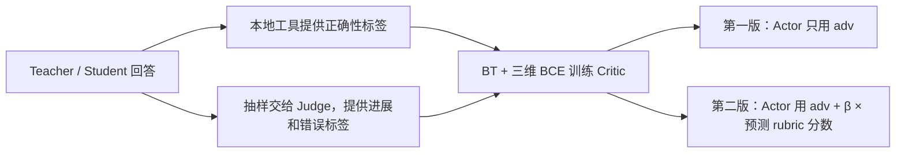

# Rubric 两版设计与近两周实验汇报

初稿时间范围：2026 年 10 月 23 日至 11 月 5 日。本次补充 Rubric 接入 Actor 的正式训练与八项评估结果，沿用原文件名。本文重点说明两版 rubric 的区别、已经得到的结果，以及仍待验证的问题。

这两周的主要进展是：将原先较复杂的 Judge 流程简化为单轮评分，先完成“rubric 辅助 Critic”的实验，再验证“rubric 直接参与 Actor 奖励”。第一版出现了积极的整体结果，但提升并不均匀；第二版已完成训练和评估，八项平均正确率下界为 **25.47%**，低于第一版的 **26.70%**。它的回答更短、截断更少，但本轮没有带来进一步的准确率提升。

**研究目标：让模型既学会模仿好的回答，也学会识别解题质量。**

项目仍以 Qwen3-0.6B 和 DAPO-Math-17k 为主要设置。这里有三个角色：Actor 是实际解题的学生模型；Critic 是训练中的评分模型；Judge 是独立部署的 Qwen3-8B，用来给少量回答提供过程标签。Teacher 提供预先采好的参考回答，正式训练不需要重新调用 Teacher 生成它们。

原版 GAD 训练 Critic 把同题 Teacher 回答排在 Student 回答前面，再让 Actor 争取更高的 Critic 分数。这保留了蒸馏的方向，但“更像 Teacher”与“数学上更正确”并不完全相同。因此我们增加 rubric，希望 Critic 除了区分回答来源，还能学到答案正确性、正确进展和明显错误。

| 设置 | Critic 学什么 | GAD 阶段 Actor 使用什么奖励 |
| --- | --- | --- |
| GAD baseline | 原来的 Teacher / Student 排序 | 原对抗分数 `adv` |
| Correctness-only | 排序 + 最终答案正确性 | 仍然只用 `adv` |
| 第一版：Naive rubric | 排序 + 正确性 + 进展 + 错误 | 仍然只用 `adv` |
| 第二版：Rubric 接入 Actor | 与第一版相同 | `adv` 加上 Critic 预测的 rubric 分数 |

两版的关键区别是 **rubric 信号能否直接参与 Actor 的奖励计算**。它们使用同一套固定数学准则，并没有让 Critic 自己生成或演化 rubric。

**两版共用的评分流程：工具判答案，Judge 判过程。**

每条回答的监督分为三个维度。下面的 `c、p、e` 表示训练标签；后面带帽子的 `ĉ、p̂、ê` 表示 Critic 自己预测的分数，两者需要区分。

| 维度 | 谁提供标签 | 分数的含义 |
| --- | --- | --- |
| 正确性 `c` | 本地数学评分工具 | 最终答案正确为 1，错误为 0；无法可靠判定时不用于这一维训练 |
| 正确进展 `p` | Judge | 0：没有实质进展；0.5：已有独立成立的正确中间结果；1：可见解答充分解决题目，关键推理成立 |
| 未解决错误严重度 `e` | Judge | 0：未发现明确未解决错误；0.5：局部错误；1：破坏关键路线或结论的错误 |

Judge 看到题目、**一条实际可见的回答**、标准最终答案及截断信息。它不知道这条回答来自 Teacher 还是 Student，也不要求回答照着 Teacher 的解法写。Judge 开启 Thinking 做必要核查，最终只输出两个字段，例如：

```json
{"verified_progress": 0.5, "unresolved_error_severity": 0}
```

这个例子表示“已有正确进展，当前可见部分没有发现明确错误”，可以用于尚未写完的回答。没有最终答案时，本地正确性标签通常为 `c=0`；这与 `p=0.5、e=0` 并不矛盾：回答还没完成，但已经做对了一部分。

不能确定的过程维度返回 `null`，训练时忽略该维度。Judge 超时或耗尽输出预算也不能当成 0 分。截断本身不是过程错误，更不能一律把截断回答标成“答案错误”：如果可见部分已经给出可判定的答案，正确性仍按工具结果处理。

为控制成本，每个全局 Critic 更新小批次最多选择 **16 条不同回答**做过程监督，Teacher 和 Student 都有名额。当前常见分配为 Warmup 各 8 条，GAD 为 5 条 Teacher、11 条 Student；缓存命中时不重复请求。未选中的回答仍参与原 BT 训练和可用的正确性监督，只是不参与该轮过程损失。

这也解释了“不是每条学生回答都调用 Judge”和“rubric 没启用”的区别：我们采用的是有意控制成本的抽样监督。Critic 学到这些标签后，可以给全部学生回答预测分数。

**Judge 为什么从复杂协议改为单轮评分。**

此前尝试要求 Judge 输出步骤事件、证据位置、错误修复关系，再进行语义复核。这些设计原本是为了提高可靠性，但带来了两个实际问题：输出长、调用多；部分本来可以使用的标签，又因为证据格式或复核条件而被丢弃。工作重心逐渐变成完善标注协议，迟迟不能进入完整训练。

10 月 24 日的方案参考本地 ROPD 实现中的简短评分形式，保留固定数学准则，取消在线事件输出和第二轮复核。最终标签虽然简短，Judge 仍然可以在 Thinking 中检查推理。`verified_progress` 沿用原字段名，**只表示 Judge 判断的正确进展，并不表示经过独立证明或人工认证**。

在同一批 32 条固定输入上，并发从 2 提高到 8 后，整批耗时从 **826.8 秒降到 403.0 秒**，约减少 51%；两档都是 30/32 条可解析。主要收益是整批吞吐提高，单条长请求并没有明显变快。两条失败都是 Thinking 耗尽预算，说明简化 JSON 后，推理本身仍是主要成本。

这次简化没有消除 Judge 的误判。例如，符号改写有时仍被算成实质进展，严重计算错误有时被低估。因此当前接受的是“有噪声、需要用训练验证价值的监督”，没有把高解析率写成高数学准确率。[固定样本报告](../reports/judge_direct_v1_20261025/README.md)

**第一版：用 rubric 辅助 Critic，间接影响 Actor。**

Critic 保留一个共享的模型主干，同时输出四个分数：原来的 `adv`，以及正确性、进展、错误三个辅助分数。辅助分数经过 sigmoid 后落在 0 到 1 之间。它们是模型预测，不能直接当成已经校准的概率。

原 BT loss 保持不变：

```text
L_BT = 平均[-log sigmoid(adv_teacher - adv_student)]
```

最小化这个损失，会推动 Teacher 的对抗分数高于 Student。这里并不额外假设 Teacher 每次都答对；Teacher 的数学标签也需要由工具和 Judge 判断。

三个 rubric 头分别使用 BCE 损失。通俗地说，BCE 衡量“预测分数离标签有多远”：标签为 1 时鼓励预测接近 1，标签为 0 时鼓励接近 0；标签为 0.5 时，也按 0.5 这个软目标学习。

当前的组合方式为：

```text
L_rubric = (g_c × L_c + g_p × L_p + g_e × L_e) / 3
L_Critic = L_BT + 0.1 × L_rubric

g_d = min(N_d / 4, 1)
```

`L_c、L_p、L_e` 分别是在有效标签上计算的平均 BCE；`N_d` 是全局批次去重加权后的有效标签数。没有标签的维度不贡献损失；少于 4 条时降低该维度权重，避免极少数标签影响过大。分母固定为 3，缺少过程标签时，不会把它们的权重自动转给正确性。

**BT 和 rubric loss 相加是正确的。**相加的是两个需要降低的预测误差，不是把高质量分数当成惩罚。错误头也使用正的 BCE 系数：有严重错误时，我们要教它准确预测较高的 `e`。只有在后面给 Actor 计算奖励时，错误分数才取负号。

第一版中，Actor 的奖励仍然是：

```text
R_Actor = adv
```

因此 rubric 对 Actor 的影响要经过“辅助训练改善共享主干 → 原 adv 判断改变 → Actor 更新改变”这条路径，传导可能较弱。10 月 25 日的排序诊断也支持谨慎判断：baseline 和 correctness-only 的两个最终 Critic，在同一批 540 个同题正误回答对上的总体排序正确率都是 59.17%，没有看到清楚的提升。该诊断不包含后来完整的 naive rubric 模型。[排序诊断](../reports/critic_ranking_20261025/README.md)

Rubric 从 Warmup 就开始训练 Critic，GAD 阶段继续更新，并非提前训练一个随后冻结的评分模型。Warmup 也不是全程冻结 Actor：保留原流程，先进行 Critic 预热，达到设置的起始步后，Actor 使用 Teacher 回答做监督学习。SeqKD 是另一条独立基线，不是 Warmup 的起点。

**第二版：把 Critic 的 rubric 预测直接用于 Actor 奖励。**

第二版保留上述 Critic 联合损失，只改变 GAD 阶段给 Actor 的奖励：

```text
R_Actor = adv + β × (w_c × ĉ + w_p × p̂ - w_e × ê)

本轮：β = 0.05，w_c = w_p = w_e = 1
```

其中 `ĉ、p̂、ê` 都来自 Critic，**不是直接把 Judge 刚打出的标签塞给 Actor**。Judge 仍只负责抽样标注，Critic 负责把所学的判断用于所有新回答。因此这次接入不额外增加 Judge 请求，也不需要再训练一个独立奖励模型。

两条信号通路可以这样理解：



图中表示信号如何传递。实际一个 GAD 步骤中，先用当前 Critic 给新回答打分并计算优势，再标注和更新 Critic，最后用已经算好的优势更新 Actor；不会把同一步 Critic 刚学到的标签立即重新打分回灌给 Actor。

Actor 沿用原来的 GRPO 更新和 KL 约束，并没有增加一个 Actor 的 BCE loss。可以理解为：同一道题生成两条回答，比较它们的奖励，再增加相对高分回答的生成倾向。当前每题只有两条回答，GRPO 又按组内标准差归一化，因此通常**谁排在前面，比原始分差增大多少更关键**。奖励均值上升，不一定意味着 Actor 获得了明显不同的训练信号。

这里有两个独立系数：`λ=0.1` 控制 rubric 对 Critic 学习的影响；`β=0.05` 控制预测 rubric 分数对 Actor 奖励的影响。不能把两者混成一个“rubric 权重”。

第二版复用第一版已经完成的 **Warmup step271**，带入 Actor、四头 Critic 和数据游标，新建 GAD 实验，再训练 271 步到累计 step542。它不是在第一版已经训练完的 GAD step542 上继续追加训练。这样能减少重跑成本，也尽量保持比较起点一致。

另有一份 Actor `c-only` 消融配置：仍训练完整的三维 Critic，但 Actor 奖励只加 `β × ĉ`。它与此前“Critic 只学正确性”的 correctness-only 实验不同，用于检查 Actor 的过程奖励是否提供了超出正确性奖励的收益。本次结果表不包含这项消融。

**正式结果：第一版有积极迹象，Actor 接入本轮未进一步提高准确率。**

下面使用现有文件中相同的 `all8_dapo_v2_af1_taskn_16k` 评估口径：non-thinking，输出上限 16384，seed=42。AIME24、AIME25、AMC23、GPQA 每题采样 8 次；MATH-500、Olympiad-Bench、MMLU-Pro-Math 每题 2 次；Minerva 每题 4 次。每个模型共 8,524 条回答，已核对样本齐全。

主指标是所有采样回答的平均正确率，不是“采多次，只要一次正确就算对”。表中统一列出固定分母下的**已确认正确率下界**，单位为 %；无法可靠评分的少量回答仍保留在分母中，不等同于已确认答错。最后的平均对任务等权，GPQA 也在八项平均内。

| 任务 | SeqKD | GAD baseline | Correctness-only | Naive rubric | Actor-rubric |
| --- | ---: | ---: | ---: | ---: | ---: |
| AIME24 | 3.75 | 2.92 | 1.67 | 5.42 | 3.33 |
| AIME25 | 4.58 | 7.50 | 6.25 | 6.67 | 7.08 |
| AMC23 | 26.88 | 28.12 | 33.44 | 29.69 | 30.31 |
| MATH-500 | 52.20 | 52.80 | 54.30 | 54.60 | 54.80 |
| Minerva | 10.66 | 15.35 | 16.54 | 14.98 | 13.79 |
| Olympiad-Bench | 23.33 | 23.04 | 24.96 | 26.59 | 25.19 |
| GPQA | 24.12 | 24.49 | 23.61 | 23.74 | 22.10 |
| MMLU-Pro-Math | 39.71 | 45.11 | 45.41 | 51.92 | 47.19 |
| 原四项平均 | 21.85 | 22.84 | 23.91 | 24.09 | 23.88 |
| 扩展四项平均 | 24.46 | 27.00 | 27.63 | 29.31 | 27.06 |
| **八项平均** | **23.15** | **24.92** | **25.77** | **26.70** | **25.47** |

对应八项平均的评分未决范围依次为 **23.15–23.94、24.92–25.69、25.77–26.56、26.70–27.44、25.47–26.30**。这些上下界反映评分工具未能判定的部分，不是统计置信区间。

Naive rubric 的八项平均下界比 GAD baseline 高 **1.78 个百分点**，比 correctness-only 高 **0.93 个百分点**。主要变化出现在扩展任务，特别是 MMLU-Pro-Math：相对 baseline 提高约 6.81 个百分点。原四项平均相对 correctness-only 只高约 0.18 个百分点；AMC23 和 Minerva 还出现下降。

Actor-rubric 相对 naive rubric 的八项平均下界下降 **1.23 个百分点**，相对 correctness-only 低 **0.30 个百分点**，仍比 GAD baseline 高 **0.56 个百分点**。与 naive rubric 相比，八项中三项小幅提高、五项下降。原四项平均只下降约 0.21 个百分点，扩展四项下降约 2.25 个百分点；其中 MMLU-Pro-Math 从 51.92% 降到 47.19%，贡献了八项平均降幅的大约一半。

为检查本次差值是否容易由评测题目波动解释，额外做了按题配对重采样：每题先平均多次回答，在各任务内分别有放回抽样 5,000 次，再对八项等权平均，seed=42。Actor-rubric 减 naive rubric 的差值，其 95% 重采样区间约为 **[-2.35，-0.10] 个百分点**；MMLU-Pro-Math 为 **[-6.81，-2.70] 个百分点**。这表明本次回落值得认真对待，但区间只描述这两个 checkpoint 的评测样本波动，不包含训练 seed 变化，也不消除实现精度等混杂。这里检验的是正确率下界，不能与上一段“评分未决范围”混为一谈。

目前两版的结论需要分开：**rubric 辅助 Critic 出现了值得继续验证的收益；直接把三个预测分数加到 Actor 奖励，本轮没有保住第一版的全部增益。**不能据此否定所有 Actor-rubric 方案，也不能把第一版的正面结果说成已由第二版进一步证明。

这些仍是单次训练结果。旧 baseline/correctness-only 与 naive rubric 的历史训练 scorer 和部分执行设置不同，统一本次评估不会追溯统一历史训练标签。两版 rubric 的对照更接近：确认复用同一 Warmup271、同一训练数据和训练 scorer，评测采样协议、各任务评分规则一致，且都评估最终 step542；但奖励计算精度仍不同，详见下文。GPQA 是跨领域补充评估，扩展数学任务也有评分覆盖限制，不作为上游官方协议成绩。

本表对应的 run 为 `baseline_06b_17k`、`correctness_06b_17k_20261021`、`rubric_direct_06b_17k_20261026` 和 `rubric_actor_06b_17k_v1`。原四项指 AIME24、AIME25、AMC23、MATH-500；其余四项为扩展任务。数据来源是各任务 `scores/metrics.json` 的 `sample_accuracy_lower/upper`，不是另用一套 `card_metric` 重新算分。

**回答更容易写完了，但完成率提高没有转化为总体准确率提高。**

与 naive rubric 相比，Actor-rubric 在八项任务上的截断率和平均生成长度都降低了。按全部 8,524 条评测回答汇总，截断比例由 **16.83% 降到 13.53%**，平均长度由约 **6,479 降到 5,709 tokens**，减少约 12%。这里按回答数量汇总，与前面按任务等权的准确率平均不同。

不过，只看各自正常结束的回答，八项的已确认正确率也都更低。下面列出四个代表任务：

| 任务 | Naive 截断率 | Actor 截断率 | Naive 正常结束正确率下界 | Actor 正常结束正确率下界 |
| --- | ---: | ---: | ---: | ---: |
| AIME24 | 65.42% | 55.42% | 15.66% | 7.48% |
| MATH-500 | 16.00% | 12.40% | 64.64% | 62.44% |
| Olympiad-Bench | 33.63% | 27.63% | 39.17% | 34.70% |
| MMLU-Pro-Math | 10.18% | 7.81% | 57.35% | 50.90% |

两种模型正常结束的回答集合并不相同，更多难题能写完也可能拉低这个条件正确率，因此不能直接说“同一道题的推理都变差了”。但结合总体分数，可以确认：**本轮更容易结束回答，并不足以抵消其他质量变化。**MMLU-Pro-Math 的回落也不只是因为截断：明确错误选项从 910 条增至 1,018 条，格式失败从 122 条增至 178 条；两版使用的是同一评分规则。仅凭回答变短，尚不能认定模型学会了更高效的推理。

**全程训练检查：奖励已接通，但直接改变排序的次数很少。**

11 月 3 日先完成三步训练和保存恢复检查，随后进行了正式训练。本次正式 run 已从 Warmup271 完成 **271 次 GAD 更新，到 step542**；退出码为 0，checkpoint 检查通过，Actor 和 Critic 各更新 271 次，日志无重复步或缺步。八项评估使用该最终模型，样本齐全，没有误测成 Warmup 权重。[训练完成记录](../runs/rubric_actor_06b_17k_v1/stage_gad.json)

全程共观察 34,688 条学生回答、17,344 个同题回答对。在这些**相同回答上**比较加 rubric 前后的分数：

| 观察项 | 结果 |
| --- | ---: |
| 原来有高低顺序，加入 rubric 后顺序反转 | 27 / 17,344 对，约 0.16% |
| 原来同分，加入 rubric 后分出高低 | 28 / 17,344 对，约 0.16% |
| 上述两类合计 | 55 / 17,344 对，约 0.32% |
| 一对一错、且正确性标签有效的回答对 | 2,392 对 |
| 其中正确回答严格排在前面的数量 | 加入前 1,605 对，加入后 1,607 对 |

27 次严格翻转中，17 次发生在两个回答都截断的情况。真实 GRPO 优势与按混合奖励重算的结果最大差值为 0，说明这次不是“配置打开了，但奖励没传进去”。然而，`β=0.05` 对同题偏好的直接干预确实非常稀疏，这与预实验的判断一致。

上述比较是**本轮 Actor 训练内部的即时重算**，不是把旧版与新版全部训练轨迹逐条对齐。由于后续生成和 Critic 都会继续变化，少量更新差异仍可能积累成不同策略；不能把“只有 0.32% 改变排序”解释成两次训练几乎完全相同，也不能凭最终退步就认定过程奖励过强。

标注通路也正常工作：本轮共发送 4,336 次 Judge 请求，4,168 次可解析，没有二次复核或自动重试；学生进展和错误维度分别得到 2,821、2,820 条有效监督。解析成功不等于数学判断正确，辅助头能输出不同分数也不等于这些分数足够可靠。全程进展头对 Judge 标签的平均绝对误差约 0.245，错误头约 0.415，后续仍需关注哪些排序变化是在奖励真实的数学质量。

解释结果时还要保留一项已知差异：**新版混合奖励采用 FP32，旧 `adv_only` 路径保留原 BF16。**同题排序不变时，计算优势的数值也可能不同。因此这次比较还不是完全只改变 rubric 奖励的对照；当前实现中简单设 `β=0` 会回到旧路径，并不自动得到 FP32 的纯 adv 对照。

成本方面，两版同样只比较 GAD 阶段：naive rubric 的阶段墙钟约 **51.04 小时**，Actor-rubric 约 **51.76 小时**。后者普通训练步的耗时中位数约 708 秒，标注环节中位数约 322 秒，没有观察到整轮提速。奖励混合仍复用 Critic 前向，但输入长度、Judge 响应和运行环境会波动，这两个时间不能当作严格速度消融。Replay buffer 仍关闭，自演化 rubric 尚未开展。

**这两周同时完成的配套工作。**

| 工作 | 进展与当前口径 |
| --- | --- |
| 截断问题与数据选择 | 检查了 8192 下大量回答未写完的问题，也试过只保留正确且未截断的 Teacher 回答。但筛选同时改变数据量和更新步数，不能作为只改变截断的严格消融。当前正式路线已回到完整 17k，本文结果不混入 `cnt` 实验。 |
| 评估修复与扩展 | 接入 Minerva、Olympiad-Bench、GPQA、MMLU-Pro-Math，补充选择题提取、单位和答案形式处理；修复训练进程误匹配等启动问题。评估默认输出改为 16384，训练输出仍为 8192。扩大评估预算不等于解决了训练中的截断。 |
| 训练提速 | 后续实验沿用关闭 Actor/Critic/Reference offload、开启梯度检查点、Critic microbatch=2、允许 rollout CUDA Graph 的组合。之前的短测支持部分方向，但不能把它们相加成整轮提速倍数。 |
| 训练曲线 | 已接入 W&B 离线上传并实际上传成功，补充阶段步数，便于区分 Warmup 和 GAD 的曲线。 |
| API 采样 | 已配置并使用 DeepSeek 兼容 API 的 non-thinking 采样，保存可见回答正文，支持按样本断点续采。non-thinking 回答仍可以有解题步骤，只是不要求接口返回隐藏思维链。新 API 数据尚未用于上表这些实验。 |
| 迁移 | 已整理最新源码、backend 重建材料、OPRD 依赖、评测数据及独立资产包的迁移步骤，并开始整理 GitHub 发布副本。复用 Warmup 需额外携带 checkpoint；目标服务器完整安装和训练尚未在本轮验证。 |

对截断的认识也做了调整：此前观察到 correctness-only 在部分“正常结束回答”上更准确，却更容易写满长度，说明总体分数同时受解题质量和完成率影响。但这只是条件统计，不能证明两组模型在同一批题上已经取得相同方向的提升，也不能仅凭相关性认定 Teacher 截断就是唯一原因。

接下来更有价值的是先把对照做清楚：补一个与混合奖励同为 FP32 的纯 adv 设置，再用 Actor `c-only` 区分正确性奖励和过程奖励的作用。是否调整 β，应看固定开发样本中的排序变化是否更可靠，而不是为了提高翻转率直接放大权重。本轮不建议仅凭当前结果重做一套复杂 Judge；先回答“奖励怎么传给 Actor 才有用”，再决定是否需要扩大过程标签或修改判据。本文仅提出后续方向，没有启动新的训练或消融。

**材料索引。**

- [单轮 Judge 设计](20261024/Judge单轮简化与训练验证方案.md)；[固定样本与并发实验](../reports/judge_direct_v1_20261025/README.md)。
- [Judge 接入 Warmup → GAD 及保存恢复验证](../reports/judge_direct_training_20261026/README.md)。
- [Actor 接入计划](20261024/Rubric信号接入Actor与复用Warmup实施计划.md)；[Actor 接入验证结果](../reports/rubric_actor_20261103/README.md)。
- [Baseline/SeqKD 评估](../runs/baseline_06b_17k/evaluation/all8_dapo_v2_af1_taskn_16k/)；[Correctness-only 评估](../runs/correctness_06b_17k_20261021/evaluation/all8_dapo_v2_af1_taskn_16k/)；[Naive rubric 评估](../runs/rubric_direct_06b_17k_20261026/evaluation/all8_dapo_v2_af1_taskn_16k/)；[Actor-rubric 评估](../runs/rubric_actor_06b_17k_v1/evaluation/all8_dapo_v2_af1_taskn_16k/)。
- Actor 全程依据：[逐步奖励与标注记录](../runs/rubric_actor_06b_17k_v1/gad/extension_metrics.jsonl)、[训练日志](../runs/rubric_actor_06b_17k_v1/logs/gad.log)。截断分层与按题重采样使用两版各任务的 `scores/scored_samples.jsonl`；数学任务沿用 `scoring.math.evaluation_value` 将已有评分映射为评估值，没有重新判分。
- 对照实现：[Judge 提示词](../rubric/prompts/judge_math_process_direct_v1.txt)、[Critic 辅助损失](../rubric/core/losses.py)、[Critic 更新](../gad/extensions/worker.py)、[Actor 奖励混合](../gad/extensions/actor_reward.py)。

本文只整理现有证据，并在 CPU 上统计已有结果，没有修改训练代码、配置、模型或历史评估文件。正文已把 Actor 版从“训练中”更新为“训练与八项评估完成”；历史报告中的旧状态仍对应当时日期，原记录不覆盖。
